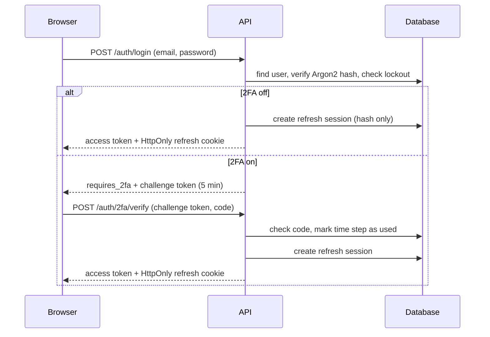
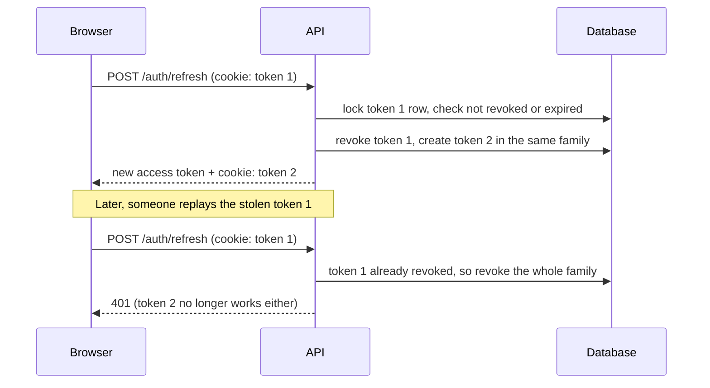

# Secure Authentication System

Signup and login with Argon2 password hashing, JWT access tokens, rotating refresh-token sessions and TOTP two-factor authentication.

**Stack:** FastAPI · SQLAlchemy 2.0 · Alembic · PostgreSQL · Next.js (TypeScript) · PyOTP

## Features

| Area | What it does |
|---|---|
| Passwords | Argon2id hashing, transparent rehash when parameters change, 12–128 character rule |
| Login errors | One generic message and equal timing for unknown emails and wrong passwords |
| Access tokens | Short-lived JWT (HS256) with pinned algorithm and required `iss`, `aud`, `exp`, `iat`, `sub`, `typ` claims |
| Refresh tokens | Random 256-bit token in an `HttpOnly`, `SameSite=Strict` cookie; only its SHA-256 hash is stored |
| Rotation & reuse detection | Every refresh issues a new token; replaying an old one revokes the whole session family |
| Account lockout | Locks an account for a period after repeated wrong passwords or 2FA codes |
| Two-factor auth | TOTP (authenticator apps), secret encrypted at rest with Fernet, QR code setup, single-use codes |
| Rate limiting | Per-IP limits on login, signup, 2FA verify/disable and refresh (HTTP 429) |
| Frontend | Access token kept in memory only; silent refresh on page load and on expiry |

## Repository layout

```
backend/
  app/
    core/          settings, security helpers, rate limiter
    db/            SQLAlchemy engine and session
    models/        User, RefreshSession
    routers/       /auth and /auth/2fa endpoints
    schemas/       request/response models
    services/      refresh-session and TOTP logic
  alembic/         database migrations
  tests/           pytest suite
frontend/
  app/             pages: /login, /signup, /dashboard
  components/      UI and the 2FA panel
  lib/             API client and auth context
docs/              architecture notes
```

## Prerequisites

- Python 3.10+
- Node.js 20+
- PostgreSQL 14+

## Setup

### 1. Database

Create an empty database (the name is up to you; it goes in `DATABASE_NAME` below):

```bash
psql -U postgres -c "CREATE DATABASE secure_auth;"
```

### 2. Backend

From the repository root:

```bash
python -m venv .venv
# Windows (PowerShell):  .venv\Scripts\Activate.ps1
# macOS / Linux:         source .venv/bin/activate
pip install -r backend/requirements.txt
```

Create `backend/.env`. Every setting is required; the app refuses to start if one is missing.

```ini
# Database
DATABASE_NAME=secure_auth
DATABASE_USER=postgres
DATABASE_PASSWORD=your-postgres-password
DATABASE_HOST=localhost
DATABASE_PORT=5432

# The website allowed to call the API (CORS)
FRONTEND_ORIGIN=http://localhost:3000

# JWT access tokens
JWT_SECRET_KEY=<generate, see below>
JWT_ALGORITHM=HS256
JWT_ISSUER=secure-auth-api
JWT_AUDIENCE=secure-auth-web
ACCESS_TOKEN_EXPIRE_MINUTES=15

# Brute-force protection
MAX_FAILED_LOGIN_ATTEMPTS=5
ACCOUNT_LOCKOUT_MINUTES=15

# Refresh tokens
REFRESH_TOKEN_EXPIRE_DAYS=7
COOKIE_SECURE=false

# Two-factor authentication
TOTP_ENCRYPTION_KEY=<generate, see below>
TOTP_ISSUER_NAME=SecureAuth
TWO_FA_CHALLENGE_EXPIRE_MINUTES=5

# Rate limiting (per IP address)
RATE_LIMIT_STORAGE_URI=memory://
RATE_LIMIT_LOGIN=5/minute
RATE_LIMIT_SIGNUP=3/minute
RATE_LIMIT_REFRESH=30/minute

# Automated tests (this database is deleted and recreated on every test run)
TEST_DATABASE_NAME=auth_test
```

Generate the two secrets:

```bash
python -c "import secrets; print(secrets.token_urlsafe(64))"                                  # JWT_SECRET_KEY
python -c "from cryptography.fernet import Fernet; print(Fernet.generate_key().decode())"     # TOTP_ENCRYPTION_KEY
```

> Never commit `.env`. Changing `TOTP_ENCRYPTION_KEY` later makes every saved 2FA secret unreadable.

Create the tables and start the API:

```bash
cd backend
alembic upgrade head
uvicorn app.main:app --reload
```

The API runs at http://localhost:8000, with interactive docs at http://localhost:8000/docs.

### 3. Frontend

Create `frontend/.env.local`:

```ini
NEXT_PUBLIC_API_URL=http://localhost:8000
```

Then:

```bash
cd frontend
npm install
npm run dev
```

Open http://localhost:3000. Use `localhost`, not `127.0.0.1`: the refresh cookie and CORS settings are tied to that host name.

## Running the tests

```bash
cd backend
pytest -v
```

The suite creates the `TEST_DATABASE_NAME` database, runs the Alembic migrations against it, and deletes it afterwards. It refuses to run if `TEST_DATABASE_NAME` equals `DATABASE_NAME`.

## API

| Method | Path | Auth | Purpose |
|---|---|---|---|
| POST | `/auth/signup` | – | Create an account |
| POST | `/auth/login` | – | Password step; returns an access token, or a 2FA challenge token |
| POST | `/auth/2fa/verify` | challenge token | Second login step with a 6-digit code |
| POST | `/auth/refresh` | refresh cookie | New access token; rotates the refresh cookie |
| POST | `/auth/logout` | refresh cookie | Revoke this session and clear the cookie |
| GET | `/auth/me` | access token | The logged-in user |
| POST | `/auth/2fa/setup` | access token | New TOTP secret and QR code |
| POST | `/auth/2fa/enable` | access token | Confirm a code to switch 2FA on |
| POST | `/auth/2fa/disable` | access token | Password + code to switch 2FA off |

## How login works



## How refresh-token rotation works



## Going to production

- Serve both apps over HTTPS and set `COOKIE_SECURE=true`.
- Set `FRONTEND_ORIGIN` and `NEXT_PUBLIC_API_URL` to the real addresses. `NEXT_PUBLIC_*` values are baked in at `npm run build`.
- Use Redis for rate limiting (`RATE_LIMIT_STORAGE_URI=redis://...`) so limits are shared across server processes and survive restarts.
- Behind a reverse proxy, configure Uvicorn's `--proxy-headers` and `--forwarded-allow-ips` so rate limiting sees real client IPs.
- Generate new secrets for production. Never reuse development keys.
